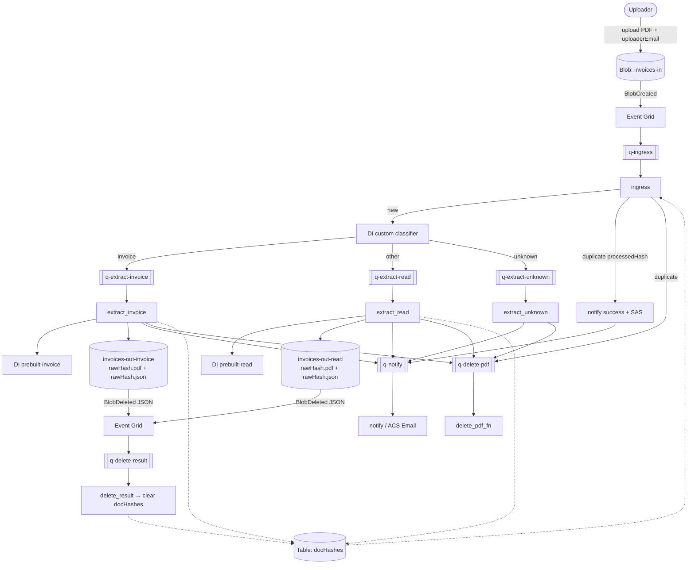

# rag-exercise — event-driven PDF pipeline in Azure (RAG course, Lab-2)

Upload a PDF to Blob Storage; **Event Grid** enqueues work; **Azure Functions** classify the document, run Document Intelligence OCR when appropriate, write results, soft-delete the input, and email the uploader (with time-limited SAS links).

Access to Storage, queues, tables, and Document Intelligence uses the Function App **system-assigned Managed Identity** (no storage/DI keys in app code). Classifier training uses the DI admin API key from the CLI script only.

## Pipeline functions

| Function | Trigger queue | Role |
|---|---|---|
| `ingress` | `q-ingress` | Dedup (`docHashes`), classify, route |
| `extract_invoice` | `q-extract-invoice` | `prebuilt-invoice` → `invoices-out-invoice` |
| `extract_read` | `q-extract-read` | `prebuilt-read` → `invoices-out-read` |
| `extract_unknown` | `q-extract-unknown` | No OCR; `format_error` notify |
| `delete_pdf_fn` | `q-delete-pdf` | Soft-delete PDF in `invoices-in` |
| `delete_result` | `q-delete-result` | On result JSON delete → clear `docHashes` |
| `notify` | `q-notify` | ACS Email to `uploaderEmail` metadata |

Classifier labels: **invoice** / **other** / **unknown** (low confidence or missing model).

Result blobs are named by content hash (`rawHash`), not upload file name:

```text
invoices-out-invoice/{rawHash}.pdf   # source copy (stable download link)
invoices-out-invoice/{rawHash}.json  # OCR JSON
# or invoices-out-read/… for "other"
```

## Architecture



**Dedup:** SHA-256 of PDF bytes (`rawHash`) is stored in `docHashes`. If `processedHash` is already set, OCR is skipped; the uploader still gets a success-style email with SAS links to the existing `{rawHash}.pdf` / `{rawHash}.json`.

**Why soft-delete + `delete_result`?** Deleting the result JSON clears the table row so the same PDF content can be processed again.

## Prerequisites

- Azure subscription with student / free credits
- [Azure CLI](https://learn.microsoft.com/cli/azure/install-azure-cli) (`az`)
- [Terraform](https://developer.hashicorp.com/terraform/install) ≥ 1.5
- `zip`, Python 3 with `azure-ai-documentintelligence` + `azure-storage-blob` (for classifier training)
- Sample PDFs under `samples/examples/{invoice,other}/` (≥5 each for training)

## Deploy

### 1. Login

```bash
az login
az account show --query id -o tsv   # copy subscription id
```

### 2. Terraform

```bash
cd terraform
cp terraform.tfvars.example terraform.tfvars
# edit terraform.tfvars → set subscription_id

terraform init
terraform plan
terraform apply
```

Resources created:

- Resource group, storage (containers `invoices-in`, `invoices-out-*`, `classifier-train`, soft-delete), queues, `docHashes` table
- Event Grid system topic + subscriptions (BlobCreated → `q-ingress`, BlobDeleted on outs → `q-delete-result`)
- Document Intelligence, Linux Consumption Function App (Python 3.11), Application Insights
- Azure Communication Services + Email (notifications)
- Managed Identity role assignments (blob / queue / table / Cognitive Services User)

### 3. Deploy function code

```bash
chmod +x scripts/*.sh
./scripts/deploy_function.sh
```

### 4. Train the custom classifier

```bash
./scripts/train_classifier.sh
```

Builds Document Intelligence classifier `rag-invoice-classifier` from `samples/examples/{invoice,other}` and sets `CLASSIFIER_MODEL_ID` on the Function App (and in `terraform.tfvars`).

Do **not** put unknown/smoke PDFs into those train folders.

### 5. Test with a PDF

```bash
./scripts/upload_pdf.sh ./samples/examples/invoice/INV20240116-092.pdf
```

The script sets blob metadata `uploaderEmail` for ACS notify.

After ~1–2 minutes:

- Input PDF is soft-deleted from `invoices-in`
- Results appear as `{rawHash}.pdf` + `{rawHash}.json` under `invoices-out-invoice` or `invoices-out-read`
- Email arrives with SAS links to both files

```bash
STORAGE="$(terraform -chdir=terraform output -raw storage_account_name)"
FUNC="$(terraform -chdir=terraform output -raw function_app_name)"
RG="$(terraform -chdir=terraform output -raw resource_group_name)"

az storage blob list --account-name "$STORAGE" --container-name invoices-out-invoice \
  --auth-mode login -o table

az functionapp log tail --name "$FUNC" --resource-group "$RG"
```

### 6. Tear down (after defence)

```bash
cd terraform && terraform destroy
```

## Example JSON

Illustrative excerpts (normalized by `shared/ocr.py`):

**`prebuilt-read`** — page text + line polygons, empty `invoiceFields`:

```json
{
  "sourceBlob": "upload-name.pdf",
  "modelId": "prebuilt-read",
  "pageCount": 1,
  "content": "…",
  "pages": [{ "pageNumber": 1, "lines": [{ "content": "…", "polygon": [] }] }],
  "invoiceFields": {}
}
```

**`prebuilt-invoice`** — same layout plus typed fields (`VendorName`, `InvoiceId`, `InvoiceTotal`, …):

```json
{
  "sourceBlob": "upload-name.pdf",
  "modelId": "prebuilt-invoice",
  "invoiceFields": {
    "VendorName": { "type": "string", "valueString": "Contoso Ltd", "confidence": 0.97 },
    "InvoiceId": { "type": "string", "valueString": "INV-1001", "confidence": 0.98 }
  }
}
```

| | `prebuilt-read` | `prebuilt-invoice` |
|---|---|---|
| When | Classifier → **other** | Classifier → **invoice** |
| Goal | Layout + plain text | Structured invoice fields |
| Best for | Non-invoice docs / RAG text | Accounting-style invoices |

## Cost estimate (1000 documents / month)

Assumptions: average **2 pages** per doc → **2000 pages/month**; classify once + **one** extract model per document (not both); Switzerland North; lab often uses Document Intelligence **F0** (free tier limits). Paid S0-style estimates:

| Service | Estimate |
|---|---|
| Custom classify + one prebuilt extract | roughly **$5–25** depending on invoice vs read mix |
| Functions Consumption + queues + small blob/table | **~$0–2** |
| ACS Email (low volume) | check current ACS pricing |
| Application Insights | often free tier at this volume |

Verify with the [Azure Pricing Calculator](https://azure.microsoft.com/pricing/calculator/).

## Project layout

```
rag-exercise/
  terraform/                 # IaC (storage, EG, queues, table, DI, Functions, ACS)
  function/
    function_app.py          # ingress / extract_* / delete_* / notify
    shared/
      classify.py            # custom classifier
      ocr.py                 # DI extract + JSON normalize
      dochashes.py           # Table Storage dedup
      storage.py             # MI clients + SAS links
      events.py              # queue JSON helpers
      notify_email.py        # ACS email
    requirements.txt
    host.json
  scripts/
    _common.sh               # RBAC / settle waits
    deploy_function.sh
    train_classifier.sh
    upload_pdf.sh
  samples/examples/
    invoice/                 # ≥5 PDFs for classifier class "invoice"
    other/                   # ≥5 PDFs for class "other"
  README.md
```

## Demo video

[Recording (2026-10-30)](./2026-10-30%2010-08-48.mp4)
