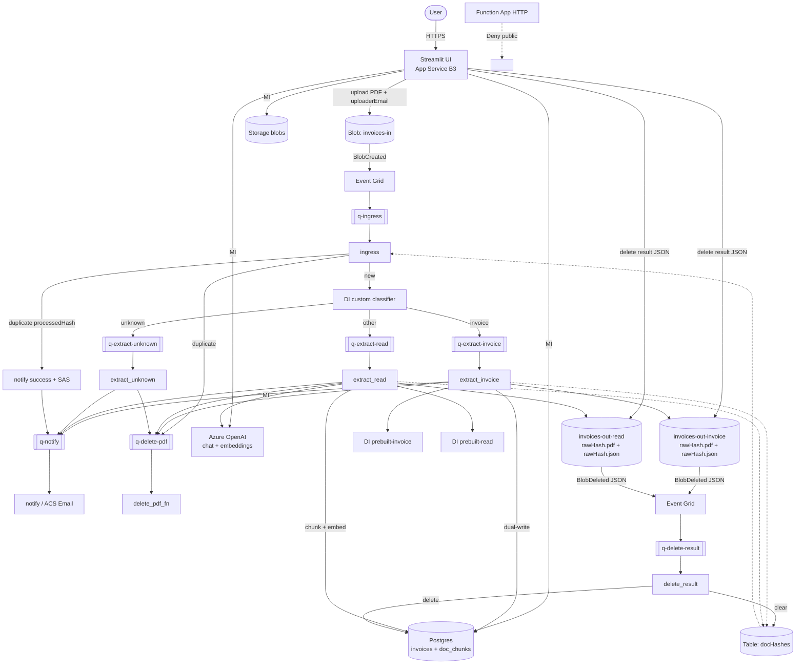

# rag-exercise

**Azure PDF pipeline + RAG chat (Labs 2–3)**

Event-driven PDF processing on Azure, plus a Streamlit chat & ops UI powered by a LangGraph agent  

that answers questions over company docs (`pgvector`) and invoice data (SQL).

    


---

## Contents

- [Overview](#overview)
- [Architecture](#architecture)
- [How it works](#how-it-works)
- [Security & public access](#security--public-access)
- [Deploy](#deploy)
- [Example JSON output](#example-json-output)
- [Cost estimate](#cost-estimate)
- [Project layout](#project-layout)

---

## Overview

> **Live UI:** [https://raglab1-ui-6hjyrm.azurewebsites.net](https://raglab1-ui-6hjyrm.azurewebsites.net)
>
> Get the URL from Terraform: `terraform -chdir=terraform output -raw ui_url`

The Streamlit UI is the **only public entry point**. Everything else is locked down (see [Security & public access](#security--public-access)).

### The UI


| Tab          | What you can do                                                                                                                                                                                                                |
| ------------ | ------------------------------------------------------------------------------------------------------------------------------------------------------------------------------------------------------------------------------ |
| **Chat**     | Talk to a LangGraph ReAct agent with two tools: • `company_rag` — semantic search over company docs (pgvector) • `invoice_sql` — read-only SQL over invoices; optional `chart=bar|line|pie` renders a Plotly chart in the chat |
| **Pipeline** | Upload PDF(s) to `invoices-in` (tagged with `uploaderEmail`) List and delete result files `{rawHash}.json` (deleting triggers `delete_result`)                                                                                 |


### Pipeline functions


| Function          | Trigger queue       | Role                                                                               |
| ----------------- | ------------------- | ---------------------------------------------------------------------------------- |
| `ingress`         | `q-ingress`         | Dedup (`docHashes`), classify, route                                               |
| `extract_invoice` | `q-extract-invoice` | `prebuilt-invoice` → blobs + Postgres `invoices` / `invoice_line_items`            |
| `extract_read`    | `q-extract-read`    | `prebuilt-read` → blobs + embed/upsert `doc_chunks`                                |
| `extract_unknown` | `q-extract-unknown` | No OCR; sends `format_error` notification                                          |
| `delete_pdf_fn`   | `q-delete-pdf`      | Soft-deletes the PDF in `invoices-in`                                              |
| `delete_result`   | `q-delete-result`   | On result JSON delete → clears `docHashes` (+ Postgres invoice row / `doc_chunks`) |
| `notify`          | `q-notify`          | ACS Email to the `uploaderEmail` metadata address                                  |


Classifier labels: `**invoice**` · `**other**` · `**unknown**` (low confidence or missing model).

---

## Architecture




---

## How it works

### Result naming

Result blobs are named by **content hash** (`rawHash`), not by the uploaded file name:

```text
invoices-out-invoice/{rawHash}.pdf   # source copy (stable download link)
invoices-out-invoice/{rawHash}.json  # OCR JSON
# or invoices-out-read/… for "other"
```

### Deduplication

The SHA-256 of the PDF bytes (`rawHash`) is stored in `docHashes`. If `processedHash` is already set, OCR is skipped — the uploader still receives a success-style email with SAS links to the existing `{rawHash}.pdf` / `{rawHash}.json`.

### Why soft-delete + `delete_result`?

Deleting the result JSON clears the table row (and related Postgres rows / chunks), so the same PDF content can be processed again.

### Invoice → Postgres dual-write

After writing `{rawHash}.json` for `prebuilt-invoice`, known fields are upserted into `invoices` / `invoice_line_items` (PK = SHA-256 of the JSON bytes = `processedHash`).

- Deleting that JSON blob also deletes the Postgres row.
- Other Document Intelligence fields are ignored.
- Non-invoice JSON stays blob-only (plus RAG indexing for `other`).

### RAG (Lab 3)


| Piece        | Details                                                                                                                                     |
| ------------ | ------------------------------------------------------------------------------------------------------------------------------------------- |
| Vector store | Postgres with the `vector` extension, table `doc_chunks`                                                                                    |
| Models       | Azure OpenAI (`swedencentral`, GlobalStandard): `text-embedding-3-small` + `gpt-4.1-mini`                                                   |
| Indexing     | After `extract_read` writes the JSON: chunk each page (~800 tokens, 15% overlap) → embed → upsert `doc_chunks`                              |
| Cleanup      | Deleting the JSON clears chunks by `raw_hash`                                                                                               |
| Invoices     | **Not** embedded — query them via `invoice_sql` (`total_tax`, totals, vendors, …). Optional `chart` returns a Plotly payload the UI renders |


---

## Security & public access

Access to Storage, queues, tables, Document Intelligence and Azure OpenAI uses **system-assigned Managed Identity** (Function App + UI). Classifier training still uses the DI admin API key — from the CLI script only.


| Surface            | Exposure                                                                                 |
| ------------------ | ---------------------------------------------------------------------------------------- |
| Streamlit UI       | **Public HTTPS** (the only intentional entry point)                                      |
| Storage data-plane | Deny + `AzureServices` bypass + **UI App Service outbound IPs** allowlisted              |
| Function App HTTP  | Deny (queue/blob triggers only; SCM open for zip deploy)                                 |
| Postgres           | `AllowAzureServices` only (Consumption / App Service have no fixed VNet on this lab SKU) |


---

## Deploy

### Prerequisites

- Azure subscription with student / free credits
- [Azure CLI](https://learn.microsoft.com/cli/azure/install-azure-cli) (`az`)
- [Terraform](https://developer.hashicorp.com/terraform/install) ≥ 1.5
- `zip`, `rsync`, Python **3.11** (the UI zip packs deps locally — Oryx remote pip is heavy on small plans)
- `azure-ai-documentintelligence` + `azure-storage-blob` (classifier training)
- Sample PDFs under `samples/examples/{invoice,other}/` (≥ 5 each for training)

### 1. Log in

```bash
az login
az account show --query id -o tsv   # copy subscription id
```

### 2. Provision infrastructure (Terraform)

```bash
cd terraform
cp terraform.tfvars.example terraform.tfvars
# edit terraform.tfvars → set subscription_id (ui_sku_name default B3)

terraform init
terraform plan
terraform apply
```

**Resources created**

- Resource group, storage (containers `invoices-in`, `invoices-out-*`, `classifier-train`, soft-delete), queues, `docHashes` table
- Event Grid system topic + subscriptions (BlobCreated → `q-ingress`, BlobDeleted on outs → `q-delete-result`)
- Document Intelligence, Linux Consumption Function App (Python 3.11), Application Insights
- Azure Communication Services + Email (notifications)
- **PostgreSQL Flexible Server** (invoice columns + `doc_chunks` / pgvector; `DATABASE_URL` on Function + UI)
- **Azure OpenAI** (embeddings + chat; often in `openai_location`, default `swedencentral`)
- **Streamlit UI** Linux Web App (public URL; Managed Identity; storage firewall gets UI outbound IPs)
- Managed Identity RBAC (Function: blob / queue / table / DI / OpenAI; UI: blob / OpenAI)


### 3. Deploy Function + UI code

```bash
chmod +x scripts/*.sh
./scripts/deploy_function.sh
./scripts/deploy_ui.sh          # preinstalls deps into .python_packages, zip → App Service
terraform -chdir=terraform output -raw ui_url
```

Current deployment: [https://raglab1-ui-6hjyrm.azurewebsites.net](https://raglab1-ui-6hjyrm.azurewebsites.net)

### 4. Train the custom classifier

```bash
./scripts/train_classifier.sh
```

Builds the Document Intelligence classifier `rag-invoice-classifier` from `samples/examples/{invoice,other}` and sets `CLASSIFIER_MODEL_ID` on the Function App (and in `terraform.tfvars`). The script temporarily opens your public IP on the storage firewall (otherwise Deny), then removes it.

> [!WARNING]
> Do **not** put unknown / smoke-test PDFs into the training folders.

### 5. Test via the UI

1. Open the [UI](https://raglab1-ui-6hjyrm.azurewebsites.net) → **Pipeline** → upload PDF(s) with `uploaderEmail`.
2. Wait ~1–2 minutes, then click **Refresh list** — or ask in **Chat** (RAG / SQL / charts).
3. `notify` still emails SAS links when the pipeline finishes.

Tail Function logs:

```bash
FUNC="$(terraform -chdir=terraform output -raw function_app_name)"
RG="$(terraform -chdir=terraform output -raw resource_group_name)"
az functionapp log tail --name "$FUNC" --resource-group "$RG"
```

### 6. Tear down

```bash
cd terraform && terraform destroy
```

---

## Example JSON output

Illustrative excerpts (normalized by `shared/ocr.py`).


|          | `prebuilt-read`              | `prebuilt-invoice`           |
| -------- | ---------------------------- | ---------------------------- |
| When     | Classifier → **other**       | Classifier → **invoice**     |
| Goal     | Per-page text                | Structured invoice fields    |
| Best for | Company docs / RAG           | Accounting-style invoices    |
| Storage  | Blob JSON + `**doc_chunks**` | Blob JSON + Postgres columns |


`prebuilt-read` — pages with plain text

```json
{
  "type": "document",
  "pages": [
    { "pageNumber": 1, "text": "Line one\nLine two" }
  ]
}
```


`prebuilt-invoice` — field name → value + confidence (`Items` as a list of row objects)

```json
{
  "type": "invoice",
  "fields": {
    "VendorName": { "value": "Contoso Ltd", "confidence": 0.97 },
    "InvoiceId": { "value": "INV-1001", "confidence": 0.98 },
    "InvoiceTotal": { "value": { "amount": 1250.0, "currency": "USD" }, "confidence": 0.95 },
    "TotalTax": { "value": { "amount": 250.0, "currency": "USD" }, "confidence": 0.95 }
  }
}
```


**Postgres columns** (unknown DI fields skipped):

- `invoices`: `vendor_name`, `customer_name`, `invoice_id`, `invoice_date`, `due_date`, `currency`, `subtotal`, `total_tax`, `invoice_total`
- `invoice_line_items`: `description`, `quantity`, `unit_price`, `amount`

---

## Cost estimate

**1000 documents / month.** Assumptions: average **2 pages** per doc → **2000 pages/month**; classify once + **one** extract model per document (not both); Switzerland North; the lab often uses Document Intelligence **F0** (free tier limits). Paid S0-style estimates:


| Service                                           | Estimate / month                                    |
| ------------------------------------------------- | --------------------------------------------------- |
| Custom classify + one prebuilt extract            | roughly **$5–25** (depends on invoice vs read mix)  |
| Functions Consumption + queues + small blob/table | **~$0–2**                                           |
| PostgreSQL Flexible Server B1ms                   | often **~$10–15**                                   |
| Streamlit UI App Service B3                       | often **~$30–40**                                   |
| Azure OpenAI embeddings + chat (lab traffic)      | usually low; watch TPM quotas / region availability |
| ACS Email (low volume)                            | check current ACS pricing                           |
| Application Insights                              | often free tier at this volume                      |


Verify with the [Azure Pricing Calculator](https://azure.microsoft.com/pricing/calculator/).

---

## Project layout

```text
rag-exercise/
├── terraform/                 # IaC: storage, EG, queues, DI, Functions, ACS, Postgres, OpenAI, UI
├── function/
│   ├── function_app.py        # ingress / extract_* / delete_* / notify
│   ├── shared/
│   │   ├── classify.py        # custom classifier
│   │   ├── ocr.py             # DI extract + JSON normalize
│   │   ├── db.py              # Postgres invoice + doc_chunks
│   │   ├── chunking.py        # per-page chunks + overlap
│   │   ├── embeddings.py      # Azure OpenAI embeddings (MI)
│   │   ├── index_docs.py      # extract_read → pgvector index
│   │   ├── dochashes.py       # Table Storage dedup
│   │   ├── storage.py         # MI clients + SAS links
│   │   ├── events.py          # queue JSON helpers
│   │   └── notify_email.py    # ACS email
│   ├── requirements.txt
│   └── host.json
├── agent/                     # Streamlit UI + LangGraph (App Service)
│   ├── app.py                 # Chat + Pipeline tabs
│   ├── graph.py               # ReAct agent
│   ├── tools/
│   │   ├── rag.py             # company_rag
│   │   └── invoice_sql.py     # invoice_sql (+ optional chart)
│   ├── charts.py              # Plotly render from tool payload
│   └── storage.py             # upload / list / delete blobs
├── scripts/
│   ├── _common.sh             # RBAC / settle / temp storage firewall
│   ├── deploy_function.sh
│   ├── deploy_ui.sh           # local pip → .python_packages → zip deploy
│   └── train_classifier.sh
├── samples/examples/
│   ├── invoice/               # ≥ 5 PDFs for classifier class "invoice"
│   └── other/                 # ≥ 5 PDFs for class "other"
└── README.md
```

