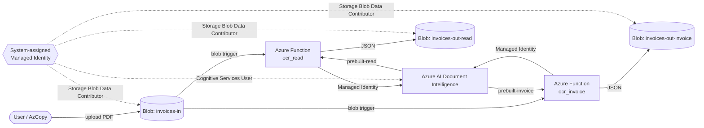

# Lab 1 — Prototype: PDF recognition in Azure

Cloud PoC that watches an Azure Blob container for PDF invoices, runs Azure AI Document Intelligence OCR, and writes JSON results to separate output containers.

Two functions are deployed in one Function App:

| Function | Model | Output container |
|---|---|---|
| `ocr_read` | `prebuilt-read` (general OCR) | `invoices-out-read` |
| `ocr_invoice` | `prebuilt-invoice` (invoice fields) | `invoices-out-invoice` |

Access to Blob Storage and Document Intelligence uses the Function App **system-assigned Managed Identity** (no API keys in code).

## Architecture



**Why separate output containers?** Writing JSON back into `invoices-in` would re-fire the blob triggers and create an infinite loop. Outputs are isolated from the input prefix.

## Prerequisites

- Azure subscription with student / free credits
- [Azure CLI](https://learn.microsoft.com/cli/azure/install-azure-cli) (`az`)
- [Terraform](https://developer.hashicorp.com/terraform/install) ≥ 1.5
- `zip` utility
- Sample invoices: [Google Drive folder](https://drive.google.com/drive/folders/1xhidQsx2mOAF0QpWY4ldkow5wxbUM0Vr)

## Deploy

### 1. Login

```bash
az login
az account show --query id -o tsv   # copy subscription id
```

### 2. Terraform

```bash
cd lab-1/terraform
cp terraform.tfvars.example terraform.tfvars
# edit terraform.tfvars → set subscription_id

terraform init
terraform plan
terraform apply
```

Resources created:

- Resource group `rg-rag-lab1`
- Storage account + containers `invoices-in`, `invoices-out-read`, `invoices-out-invoice`
- Azure AI Document Intelligence (`FormRecognizer` / S0)
- Linux Consumption Function App (Python 3.11) + Application Insights
- Role assignments for Managed Identity

### 3. Deploy function code

```bash
cd lab-1
chmod +x scripts/deploy_function.sh
./scripts/deploy_function.sh
```

### 4. Test with a PDF

Put files into `lab-1/samples/` and upload:

```bash
cd lab-1
chmod +x scripts/upload_pdf.sh
./scripts/upload_pdf.sh ./samples/invoice-01.pdf
```

or by hands:

```bash
az storage blob upload \
  --account-name ragocrstcp2689 \
  --container-name invoices-in \
  --file ./samples/invoice-01.pdf \
  --name invoice-01.pdf \
  --auth-mode login
```

After 1-2 minutes json files appear:

- `invoices-out-read/invoice-01.json` ← `ocr_read` / `prebuilt-read`
- `invoices-out-invoice/invoice-01.json` ← `ocr_invoice` / `prebuilt-invoice`

```bash
STORAGE=ragocrstcp2689
az storage blob download --account-name "$STORAGE" --container-name invoices-out-invoice \
  --name invoice-01.json --file ./invoice-01.invoice.json --auth-mode login

az functionapp log tail --name ragocr-func-cp2689 --resource-group rg-rag-lab1
```

**Deployed resources (switzerlandnorth):**

| Resource | Name |
|---|---|
| Resource group | `rg-rag-lab1` |
| Storage | `ragocrstcp2689` |
| Function App | `ragocr-func-cp2689` (`ocr_read`, `ocr_invoice`) |
| Document Intelligence | `ragocr-di-cp2689` (F0) |

### 5. Tear down (after defence)

```bash
cd lab-1/terraform && terraform destroy
```

## Example JSON

Illustrative excerpts (full samples in [`samples/examples/`](samples/examples/)):

**`prebuilt-read`** — page text + line polygons, empty `invoiceFields`:

```json
{
  "sourceBlob": "invoice-01.pdf",
  "modelId": "prebuilt-read",
  "pageCount": 1,
  "content": "INVOICE\nContoso Ltd\nInvoice Number: INV-1001\n...",
  "pages": [{ "pageNumber": 1, "lines": [{ "content": "INVOICE", "polygon": [...] }] }],
  "invoiceFields": {}
}
```

**`prebuilt-invoice`** — same layout plus typed fields (`VendorName`, `InvoiceId`, `InvoiceDate`, `InvoiceTotal`, line items):

```json
{
  "sourceBlob": "invoice-01.pdf",
  "modelId": "prebuilt-invoice",
  "invoiceFields": {
    "VendorName": { "type": "string", "valueString": "Contoso Ltd", "confidence": 0.97 },
    "InvoiceId": { "type": "string", "valueString": "INV-1001", "confidence": 0.98 },
    "InvoiceTotal": { "type": "currency", "valueCurrency": { "amount": 1250.0, "currencyCode": "USD" } }
  }
}
```

### Read vs invoice model

| | `prebuilt-read` | `prebuilt-invoice` |
|---|---|---|
| Goal | Layout + plain text OCR | Structured invoice extraction |
| Key output | `content`, `pages[].lines` | `invoiceFields` (vendor, dates, totals, items) |
| Best for | Any PDF / lab-3 citations | Accounting / invoice pipelines |

Both results store `pageNumber` so later RAG answers can cite a page.

## Cost estimate (1000 documents / month)

Assumptions: average **2 pages** per invoice → **2000 pages/month**; Switzerland North (`switzerlandnorth` — allowed by Azure for Students region policy and supports Linux Consumption Functions); both models run on every upload (as in this PoC). Note: lab deploy uses Document Intelligence **F0** (free, ~500 pages/month). Paid S0 pricing is shown below for the 1000-doc scenario.

| Service | Pricing basis (approx.) | Estimate |
|---|---|---|
| Document Intelligence `prebuilt-read` | ~$1.50 / 1000 pages | 2000 × $0.0015 ≈ **$3.00** |
| Document Intelligence `prebuilt-invoice` | ~$10 / 1000 pages (S0 custom/prebuilt invoice tier) | 2000 × $0.01 ≈ **$20.00** |
| Azure Functions (Consumption) | first 1M executions + 400k GB-s free | **~$0** at this volume |
| Blob Storage (few GB + transactions) | LRS cool/hot | **<$1** |
| Application Insights | first 5 GB/month free | **~$0** |

**Total ≈ $24–30 / month** when both models process every document.

If you keep only `prebuilt-invoice` in production: **≈ $20–22 / month**.  
Verify with the [Azure Pricing Calculator](https://azure.microsoft.com/pricing/calculator/) for your region and SKU.

## Project layout

```
lab-1/
  README.md
  terraform/          # IaC
  function/           # Azure Functions (Python v2)
    function_app.py   # ocr_read + ocr_invoice
    shared/ocr.py
    requirements.txt
    host.json
  scripts/deploy_function.sh
  scripts/upload_pdf.sh
  samples/            # local PDFs (gitignored)
    examples/         # sample JSON outputs
```

## Loom video

[Demo recording (2026-10-30)](./2026-10-30%2010-08-48.mp4)
